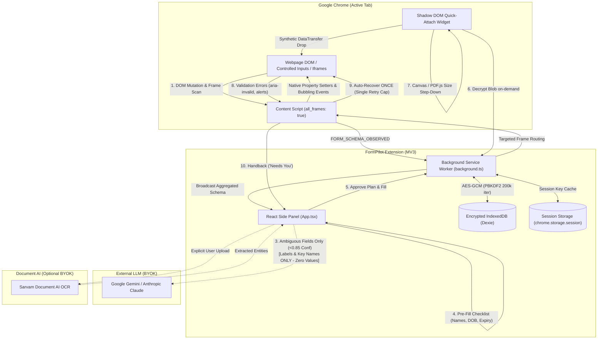

# FormPilot 🚀
### Privacy-Preserving Autonomous Form Browser Agent for Google Chrome (Manifest V3)

FormPilot is an on-device autonomous browser agent that completes complex public service, scholarship, statutory KYC, and job application forms on Google Chrome. Operating on an observable **OBSERVE → DECIDE → CHECK → ACT → ERROR RECOVERY** agent loop, FormPilot eliminates repetitive data entry while enforcing strict zero-data-leakage privacy.

---

## 🏗️ Architecture Diagram



---

## 📦 Module Overview

| Directory / Module | Responsibilities & Capabilities |
| :--- | :--- |
| `src/scanner/` | Multi-frame form observation, recursive same-origin iframe traversal, label resolution (aria, labels, placeholders, nearby text), custom comboboxes, and dropzone detection. |
| `src/decide/` | 2-tier field matcher: Local heuristic engine with fuse.js & synonym normalization (Hindi, Marathi, English) + selective LLM provider (Gemini / Claude). Generates deterministic form signatures and caches approved mappings in Dexie. |
| `src/fillers/` | Framework-compliant form filling using native prototype setters (`HTMLInputElement.prototype`), radio/checkbox state setters, custom combobox clickers, and undo history tracker. |
| `src/attach/` | Isolated Shadow DOM Quick-Attach search boxes anchored to upload slots. Fuzzy document ranker with wrong-document warnings and synthetic DataTransfer drop emulation. |
| `src/compress/` | On-device file compressor: automatic size limit detection from text hints (KB/MB), canvas JPEG quality ladder & dimension downscaling, and multi-page `pdfjs-dist` + `pdf-lib` step-down loop. |
| `src/checks/` | Pre-fill verification checklist: cross-document name comparison (token reordering, initials expansion, Levenshtein distance), DOB normalization across formats, and statutory document expiry rules. |
| `src/recovery/` | Portal validation error scanner (`aria-invalid="true"`, `role="alert"`, `.error-message`) and single-retry auto-recovery engine (re-fills, date reformats, option re-selection). |
| `src/timeline/` | Live agent event store logging `OBSERVE`, `DECIDE`, `CHECK`, `ACT`, `ERROR`, and `RECOVERY` events with millisecond timestamps (`HH:MM:SS.mmm`). |
| `src/storage/` | Zero-knowledge vault: WebCrypto AES-GCM (256-bit) encryption with PBKDF2 (200,000 iterations) and random salts. Backed by Dexie IndexedDB. |
| `src/ocr/` | Indian statutory document reader supporting Sarvam Document AI with full offline regex/tesseract fallbacks. |

---

## 🛡️ Privacy Design (Rule 1 & Rule 8 Certified)

FormPilot is built around a non-negotiable **Zero Profile Value Leakage** guarantee:

1. **Rule 1 (Privacy)**: When ambiguous fields are routed to an LLM for semantic matching, the outgoing JSON request contains **ONLY**:
   - Form field metadata: `label`, `type`, `options`, `placeholder`, `hint`, `required`, `id`.
   - List of generic profile key names and descriptions: `['fullName', 'dateOfBirth', 'phone', ...]`.
   - **Unit Test Verified**: `src/decide/privacy.test.ts` fails the build if any personal profile value, document filename, or user data ever appears in an outgoing request.
2. **Rule 8 (Local Encryption & On-Demand Decryption)**:
   - Stored documents and profile values are encrypted at rest using AES-GCM-256 with PBKDF2 key derivation (200,000 rounds).
   - In-memory keys are held in `chrome.storage.session` (memory-only, deleted upon browser close, never persisted to disk).
   - Files are decrypted only at the exact instant of user-confirmed attachment.
3. **Rule 2 (Human Handback)**:
   - FormPilot is hardcoded **never to click final Submit buttons** and **never to automate CAPTCHA or OTP challenges**, guaranteeing that legal commitment remains with the user.

---

## ⚡ How to Load the Unpacked Extension

### Prerequisites
- Node.js 18+ and npm
- Google Chrome browser

### 1. Build Extension
```bash
# Install dependencies
npm install

# Build Chrome MV3 extension
npm run build
```
The unpacked extension files are compiled to:
```
<workspace-dir>/.output/chrome-mv3/
```

### 2. Load into Chrome
1. In Google Chrome, navigate to `chrome://extensions/`.
2. Toggle on **Developer mode** in the top-right corner.
3. Click **Load unpacked** in the top-left corner.
4. Select the `.output/chrome-mv3` folder inside this project directory.
5. FormPilot is now installed! Click the puzzle icon to pin FormPilot, or press **`Ctrl+Shift+F`** (**`Command+Shift+F`** on macOS) to toggle the Side Panel.

---

## 🧪 How to Run Demo Forms Suite

The demo forms suite contains 3 realistic benchmark applications, controlled React inputs, custom dropdowns, nested same-origin iframes, deliberate size and date errors, and fake CAPTCHA steps.

```bash
cd demo-forms
npm install
npm run dev
```
Open **[http://localhost:5173/](http://localhost:5173/)** in Chrome.

You will see:
- **Overview & Pitch**: Interactive pitch, installation guide, and demo video placeholder.
- **Scholarship Form**: National Scholarship Portal mock with 200 KB size limit, controlled inputs, and fake CAPTCHA.
- **Job Application Form**: Multi-step employment application with resume upload slot.
- **KYC + Iframe Form**: Multi-frame testbed with nested bank verification iframe.

---

## ⏱️ 3-Minute Demonstration Script

| Time | Agent Step | User Action & Expected System Response |
| :--- | :--- | :--- |
| **0:00 - 0:45** | **Vault Unlock & Setup** | 1. Press `Ctrl+Shift+F` to open the FormPilot side panel.<br>2. Switch to **Profile** tab, enter a passphrase, and click **Unlock Vault**.<br>3. Upload sample test documents from `/test-documents/` (Aadhaar, Marksheet, PAN). Observe automatic document categorization and profile field extraction. |
| **0:45 - 1:30** | **Observe & Decide** | 1. Navigate to `http://localhost:5173/` (Scholarship Form).<br>2. Side panel automatically scans the form across frames, showing `9 fields found`.<br>3. Switch to **Decide** tab: review local heuristic mappings (confidence badges, option formatting: `"OBC"` → `"Other Backward Class (OBC)"`).<br>4. Observe the **Pre-Fill Verification Checklist**: flags deliberate missing required field (`Guardian Occupation`) and date formatting rules. |
| **1:30 - 2:15** | **Act & Quick-Attach** | 1. Click **Approve Plan & Fill Form**.<br>2. FormPilot fills all matching fields across frames with native property setters.<br>3. Beside the *Income Certificate* dropzone, click the floating **📎 Type to attach...** box.<br>4. Select a document: FormPilot detects the `200 KB` limit, re-encodes the image/PDF down to limit, and attaches it with a green checkmark (`✓ Compressed 800 KB -> 180 KB & Attached`).<br>5. Click **Undo** on any field to restore its previous value. |
| **2:15 - 3:00** | **Recovery & Handback** | 1. In Date of Birth, type a malformed date `2002/05/14`. Observe FormPilot's Error Scanner detecting `INVALID_DATE` and auto-reformatting to `14-05-2002`.<br>2. Open the **⏱️ Agent Reasoning Timeline** from the top header to review the timestamped audit log (`OBSERVE`, `DECIDE`, `CHECK`, `ACT`, `RECOVERY`).<br>3. Notice the agent safely stopping at the mock CAPTCHA step without touching it (Rule 2 handback). |

---

## ⚠️ Known Limitations & Boundaries

1. **Custom Canvas & Flash Forms**: FormPilot operates on HTML DOM elements (`<input>`, `<select>`, `<textarea>`, custom ARIA widgets, dropzones). Forms rendered entirely inside an HTML5 `<canvas>` (without accessibility tree elements) cannot be introspected.
2. **Proprietary Binary Upload Plugins**: Upload slots must expose either a native `<input type="file">`, a dropzone element accepting drop events, or standard ARIA file targets.
3. **Cloud OCR Service Availability**: High-accuracy Indian document parsing uses Sarvam AI Document AI via BYOK. If no API key is provided, FormPilot falls back to on-device regex and client-side extraction.
4. **Anti-Bot Gating & CAPTCHAs**: Under **Rule 2**, FormPilot strictly respects website access controls and CAPTCHAs. It will never bypass or automate CAPTCHA, OTP, or SMS verification challenges, handing control back to the user.

---

## 📊 Automated Test Results Suite

FormPilot includes 16 test suites with **115 passing unit and integration tests** executed via Vitest in a headless DOM environment:

| Test Suite File | Tests | Focus Area | Status |
| :--- | :---: | :--- | :---: |
| `src/checks/preFillChecklist.test.ts` | 11 | Name mismatch (initials, token reorder), DOB normalization, expiry checks, error-to-field mapping, single-retry limit | ✅ Passed |
| `src/compress/sizeParser.test.ts` | 5 | Text regex size limit parsing (KB/MB phrases, max limits) | ✅ Passed |
| `src/compress/compressor.test.ts` | 11 | Canvas JPEG step-down, PNG-only protection, PDF multi-page rendering | ✅ Passed |
| `src/decide/heuristicAccuracy.test.ts` | 5 | Multi-form heuristic accuracy on 4 benchmark forms (>= 90% correct) | ✅ Passed |
| `src/decide/geminiMatcher.test.ts` | 7 | LLM selective matcher fallback, confidence scoring, reason mapping | ✅ Passed |
| `src/decide/privacy.test.ts` | 4 | **Rule 1 Privacy**: Zero profile values in outgoing LLM payloads | ✅ Passed |
| `src/decide/valueFormatter.test.ts` | 14 | Date formatting, Indian phone normalization (+91), option matching | ✅ Passed |
| `src/decide/formSignature.test.ts` | 4 | Form signature hashing, cache retrieval, and manual overrides | ✅ Passed |
| `src/fillers/formFiller.test.ts` | 7 | Native setters, bubbling events, retry loops, undo records | ✅ Passed |
| `src/fillers/profileMapper.test.ts` | 5 | Profile key resolution, unconfirmed flags, candidate ranking | ✅ Passed |
| `src/attach/quickAttach.test.ts` | 19 | Fuse.js document ranking, synthetic file attachment, wrong-doc check | ✅ Passed |
| `src/scanner/formScanner.test.ts` | 3 | Label resolution, custom comboboxes, same-origin iframe recursion | ✅ Passed |
| `src/storage/crypto.test.ts` | 3 | WebCrypto PBKDF2 (200k iter) + AES-GCM-256 encryption & rejection | ✅ Passed |
| `src/ocr/sarvam.test.ts` | 9 | Job submission, polling status, entity extraction, regex fallback | ✅ Passed |
| `src/extract/regex.test.ts` | 3 | Offline regex extraction for Aadhaar, PAN, and DOB | ✅ Passed |
| `src/llm/llmValidation.test.ts` | 5 | Zod validation of LLM JSON outputs, single retry on bad JSON | ✅ Passed |
| **Total** | **115** | **Full Regression & Safety Test Suite** | **100% Passed** |

---

## 🩺 Troubleshooting & Diagnostics Guide

If any feature appears inactive, verify each component in order using Chrome's Developer Tools:

1. **Verify Background Service Worker is Active**:
   - Go to `chrome://extensions/` and find FormPilot.
   - Click `Inspect views: service worker` to open the background DevTools console.
   - Look for: `[FormPilot Background] Service worker initialized.`
   - Verify active message listener and multi-frame broadcast logs.

2. **Verify Content Script Injection**:
   - Open your form tab (e.g. `http://localhost:5173/`).
   - Open the web page DevTools (`F12` or `Ctrl+Shift+I`) and look in the Console tab.
   - Look for: `[FormPilot] Content script loaded (TOP)` or `[FormPilot] Content script loaded (IFRAME)`.
   - If missing, reload the webpage. The content script automatically matches `<all_urls>` with `all_frames: true`.

3. **Verify Form Field Scanner**:
   - In the page console, observe scan count logs:
     `[FormPilot] Scan #1 (TOP): 8 fields found (0 iframe) trigger=initial load`
   - Every DOM mutation or iframe load re-scans automatically.

4. **Verify Floating Quick-Attach Box**:
   - In the page console, check for: `[FormPilot] QuickAttach manager mounted`.
   - Floating `📎 Type to attach...` widgets automatically anchor next to every visible file input or dropzone slot.
   - To toggle manually from the side panel, use the paperclip icon in the header.

5. **Verify Side Panel**:
   - Press `Ctrl+Shift+F` (or `Cmd+Shift+F` on macOS) or click the extension icon.
   - Confirm active connection and observed field count in the top status bar.

---

## 📦 Judge Packaging Script

To package FormPilot for judges and review:
```bash
npm run zip
```
Outputs:
`dist/formpilot-extension-v1.0.0.zip` (ready for submission and distribution).
