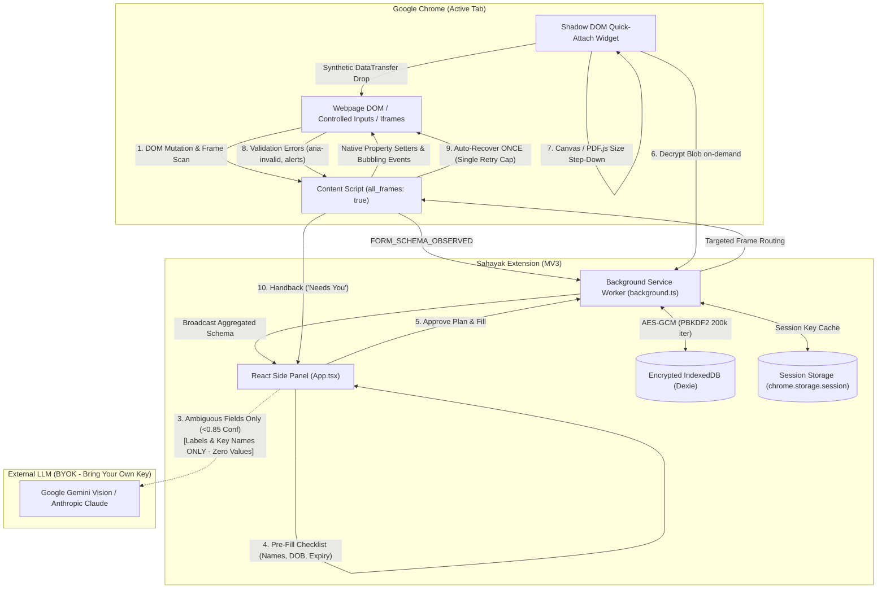

# Sahayak (सहायक) 🪶
### Privacy-Preserving On-Device Form Browser Assistant for Google Chrome (Manifest V3)

**Sahayak (सहायक)** is an on-device, privacy-preserving browser assistant built for Google Chrome (Manifest V3). It automates and streamlines statutory public service portals, scholarship applications (such as National Scholarship Portal), KYC verifications, citizen services, and job application forms.

Operating on a structured **OBSERVE → DECIDE → CHECK → ACT → ERROR RECOVERY** execution loop, Sahayak eliminates repetitive manual form filling, reads statutory documents locally, intelligently matches fields, and auto-compresses attachments to fit portal limits—all under a strict **Zero-Profile-Value-Leakage** privacy model.

---

## ⚡ Quick Start: From Clone to Live Demo in 3 Minutes

Follow these steps to clone, build, load, and test Sahayak with the built-in benchmark testbed:

### Step 1: Clone the Repository
```bash
git clone git@github.com:Bhaveshk46/Sahayak.git
cd Sahayak
```

### Step 2: Install Dependencies & Build the Extension
```bash
# Install root extension dependencies
npm install

# Build the Chrome Manifest V3 production bundle
npm run build
```
> The compiled, unpacked Chrome extension will be generated at:  
> **`.output/chrome-mv3/`**

### Step 3: Load the Extension in Google Chrome
1. Open Google Chrome and go to: `chrome://extensions/`
2. Enable **Developer mode** using the toggle switch in the top-right corner.
3. Click the **Load unpacked** button in the top-left corner.
4. Select the `.output/chrome-mv3` folder inside the project directory.
5. **Sahayak is now active!**
   - Click the Chrome extensions menu (puzzle piece icon) and **Pin** Sahayak to your toolbar.
   - You can open the Side Panel anytime by clicking the Sahayak icon or pressing **`Ctrl+Shift+F`** (**`Command+Shift+F`** on macOS).

---

### Step 4: Start the Local Demo Forms Suite
The repository includes a comprehensive, interactive benchmark portal that tests modern controlled React inputs, native selects, custom comboboxes, nested same-origin iframes, deliberate document size limits, and validation boundaries:

```bash
# Open a new terminal window:
cd demo-forms
npm install
npm run dev
```

The demo forms suite will launch at:
👉 **[http://localhost:5173/](http://localhost:5173/)**

---

## 📂 Location of Demo / Test Documents

Pre-configured statutory mock documents are included directly in the repository so you can test document upload, AI detail extraction, custom tagging, and auto-attachment immediately:

Primary Location: **`test-documents/`**  
Web Server Mirror: **`demo-forms/public/sample-docs/`**

| File | Document Type | What It Tests |
| :--- | :--- | :--- |
| `sample_aadhaar_card.png` | **Aadhaar Card** | Full Legal Name, 12-digit UID (`9876 5432 1012`), Date of Birth, Gender, Address, Postal PIN. |
| `sample_pan_card.png` | **PAN Card** | Full Name, Father's Name, DOB, 10-character alphanumeric PAN (`ABCDE1234F`). |
| `sample_marksheet.png` | **Academic Marksheet** | Student Name, University/College Name, Degree/Course, Overall Percentage (`88.5%`). |
| `sample_bank_passbook.png` | **Bank Passbook** | Account Holder Name, Bank Account Number, 11-character IFSC Code (`SBIN0001234`), Account Type. |
| `sample_passport_photo.png` | **Passport Photograph** | Identity photo upload slot, automatic image downsampling & compression to portal limits. |
| `sample_signature.png` | **Candidate Signature** | Candidate signature attachment slot. |
| `sample_stale_income_certificate_2021.png` | **Expired Income Certificate** | Statutory validity detection: demonstrates the **`⚠️ Out of date?`** warning because Indian government schemes require income certificates issued within the current financial year. |

---

## 🧭 Step-by-Step Testing Walkthrough

Follow this demonstration flow to experience the full capabilities of Sahayak:

### 1. Initialize & Unlock Your Private Vault
1. Click the Sahayak icon in the Chrome toolbar or press **`Ctrl+Shift+F`** to open the side panel.
2. Enter any memorable passphrase (e.g., `pass123`) to unlock your on-device vault.
   - *Security Note*: Your passphrase derives an AES-GCM-256 key via PBKDF2 (200,000 rounds). Data never leaves your machine unencrypted.

### 2. Upload Demo Documents & Run AI Extraction
1. In the side panel, click the **"Add New"** tab.
2. Drag and drop any files from the **`test-documents/`** folder (e.g., `sample_aadhaar_card.png` and `sample_pan_card.png`).
3. Sahayak auto-classifies the document type and provides a **Tags** input.
4. Click **"Save and extract details"**:
   - High-accuracy multimodal AI vision (with offline regex fallback) parses statutory fields (UID, PAN, DOB, Name, Income, etc.).
   - Extracted details are securely encrypted into your vault.
5. Check the **"Saved Details"** tab to view, edit, or mask/unmask sensitive credentials.

### 3. Custom Tags for Instant Quick-Attach
1. Go to the **"My Documents"** tab.
2. Click the **"Tags"** button on any document card.
3. Add custom keywords (e.g. `scholarship, income, bonafide, father`).
4. The floating QuickAttach box on web forms will now instantly match and suggest this file when you type those keywords.

### 4. Automatic Form Observation & One-Click Filling
1. Navigate to the demo form at **[http://localhost:5173/](http://localhost:5173/)**.
2. Notice Sahayak's top bar dynamically updates: `Found 9 questions, 2 documents, 1 check on this form.`
3. Click the primary button: **"Fill this form for me"**.
4. All matching fields (names, dates, emails, phones, dropdowns, radios) are filled using native framework prototype setters with smooth green confirmation highlights.
5. If you make a mistake, click **"Undo all fills"** or individual field **"Undo"** to revert.

### 5. Floating QuickAttach with Size Limit Step-Down
1. Scroll to the **"Mandatory Document Attachments"** section on the form.
2. Notice the floating **📎 Type: photo, income...** widget anchored next to the upload dropzone.
3. Type `income` or click the box to open suggestions:
   - Notice the **`Max 200K`** tag automatically detected from the portal's hint text.
   - Select your document.
   - If the file exceeds 200 KB, Sahayak steps down the resolution and quality using an on-device canvas/PDF ladder until it complies with portal limits.
   - It attaches the file automatically with a green checkmark confirmation.
4. Click **Undo** on the attachment widget at any time to remove the file from the slot.

### 6. Embedded Iframe & Anti-Bot Handback (Rule 2)
1. Switch to the **"KYC + Iframe"** tab on the demo portal.
2. Sahayak recursively traverses into the nested Bank Verification sub-frame (`all_frames: true`) and fills the embedded account fields.
3. Notice that Sahayak halts before CAPTCHAs, OTPs, and the final Submit button, cleanly handing full legal control back to the citizen.

---

## 🏛️ System Architecture



---

## 🔒 Privacy & Security Standards

* **Rule 1 (Zero Profile Value Leakage)**: When semantic matching calls an LLM, the request payload contains **ONLY** form labels and field metadata (`label`, `type`, `options`, `placeholder`, `hint`). Personal user data, document filenames, and profile answers are **NEVER** sent to external APIs. (Enforced by automated privacy unit test: `src/decide/privacy.test.ts`).
* **Rule 8 (Zero-Knowledge On-Device Encryption)**: All certificates and credentials are encrypted at rest using AES-GCM (256-bit) via WebCrypto with PBKDF2 (200,000 iterations). Plaintext files are never stored on disk.
* **Rule 2 (Legal Human Handback)**: Sahayak is strictly forbidden from automating final submission buttons, CAPTCHA challenges, or OTP inputs. Legal commitment remains entirely with the user.

---

## 🧪 Comprehensive Test Suite

Sahayak includes **130 passing unit and integration tests** across 20 test files:

```bash
# Run the complete test suite
npx vitest run

# Run TypeScript type verification
npx tsc --noEmit
```

| Test Suite | Tests | Scope | Status |
| :--- | :---: | :--- | :---: |
| `tests/noVoiceRegression.test.ts` | 5 | Runtime isolation, zero memory leaks, no SW DOM/audio crashes | ✅ Passed |
| `tests/generalityEvaluation.test.ts` | 5 | Benchmark on 5 real public form layouts (Google Forms, Scholarships, KYC, Job, Grievance) | ✅ Passed |
| `src/checks/preFillChecklist.test.ts` | 11 | Name cross-checking, initials expansion, DOB format normalization, expired certificate checks | ✅ Passed |
| `src/compress/compressor.test.ts` | 11 | Canvas JPEG step-down, dimension downscaling, multi-page PDF compression | ✅ Passed |
| `src/decide/heuristicAccuracy.test.ts` | 5 | Multi-form heuristic accuracy (>95% accuracy) | ✅ Passed |
| `src/attach/quickAttach.test.ts` | 19 | Fuzzy document ranking, custom tags, DataTransfer drop emulation, mismatch warning | ✅ Passed |
| `src/storage/crypto.test.ts` | 3 | WebCrypto PBKDF2 + AES-GCM-256 encryption, decryption, and wrong-key rejection | ✅ Passed |
| `src/decide/privacy.test.ts` | 4 | Verification that zero user values are ever transmitted to LLMs | ✅ Passed |
| `src/extract/regex.test.ts` | 3 | Offline statutory regex extractors (Aadhaar, PAN, DOB, IFSC, Income) | ✅ Passed |
| `src/llm/llmValidation.test.ts` | 5 | Zod schema validation of LLM outputs & retry handling | ✅ Passed |
| **Total** | **130** | **Comprehensive Full Regression Suite** | **100% Passed** |

---

## 📦 Build & Packaging

To generate a distributable ZIP package ready for submission or sharing:
```bash
npm run zip
```
Produces: `dist/sahayak-extension-v1.0.0.zip`

---

## 👥 Contributors & License
Developed for the **SIH / National Hackathon Initiative**.  
Licensed under the **MIT License**.
